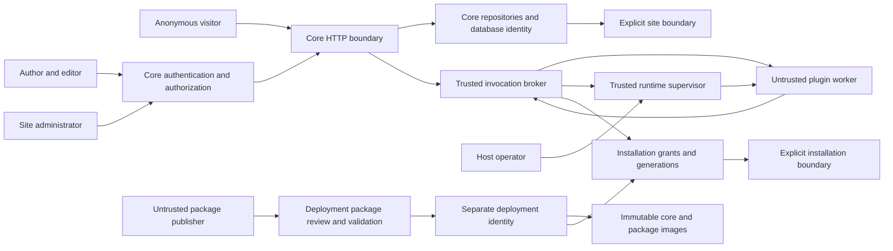

# AxiomPress architecture and authority

Status: independent fork under development. This describes implemented boundaries and target decisions; it does not claim a completed replacement CMS or production isolation. Follow AGENTS.md, AXIOMPRESS_RELEASE_POLICY.md and FORK_PROVENANCE.md. Legacy WordPress remains available for comparison and data access during staged replacement.

## Trust boundaries

Only the anonymous native HTTP path and the operator-driven broker prototype are implemented. Authentication shown above remains core-owned target work; inherited pluggable authentication does not meet that target. A site administrator does not acquire host/deployment authority. A publisher or plugin is not trusted because a package has a digest or signature. The broker/supervisor, core, database service and deployment identities are trusted computing base components; a compromised host administrator is outside worker containment claims.

## Initial platform decisions

- Initial product is single-site. Site and extension-installation identities remain independent mandatory scopes. No initial network administration, cross-site plugin authority or full WordPress multisite compatibility. Adding multisite changes configuration/ownership and requires independent cross-site tests, not just an extra URL parameter.
- New core and extension infrastructure require 64-bit PHP 8.5. Core owns request-local services and configuration; no arbitrary PHP configuration or extension autoloading. Native development uses a standalone HTTP adapter; production request handling will use FPM behind a trusted HTTP server. Long-lived core workers are deferred until reset/resource behavior is proven. Retained WordPress modules still have their inherited lifecycle and are not silently converted by this decision.
- Plugins use one process/container per invocation, no warm reuse across sites/installations, no nested plugin calls, no runtime package install and no direct core credentials. Attached framed stdio binds transport to a supervisor-created image; actor/site/install identity comes from trusted context, never JSON claims. The current capability surface is content.read and constrained component.render only.
- Shared single-host admission permits four global workers and one per site/install, with zero queue capacity. Busy work fails immediately. This is deliberately below the earlier design's 32-item maximum queue allowance; it avoids retaining authority while waiting. A queue requires explicit wait budgets and dequeue reauthorization before implementation. No fairness or multi-host coordination is promised.
- Restricted runc is the verified local experimental runtime. gVisor systrap is the next production-isolation integration target after successful PHP/framing and 11 nested OCI boundary probes. Neither the runc experiment nor the privileged nested toolbox is an approved hostile-code production deployment. Native-host resource/security acceptance remains mandatory. Docker runtime configuration is never changed implicitly by the evaluation tooling.
- SQLite owns local operator installation/image/grant policy, separate from CMS content. New installs are disabled, updates cannot change plugin identity, each explicit policy change increments generation, and active invocations recheck it. Offline policy restore requires stopping all authorities; generation alone does not prevent backup rollback. SQLite is not a decision to use SQLite for the CMS domain schema.
- PostgreSQL 18 is selected for the new domain model, following 18 actual transaction, password-authentication, row-policy, role, revision, tenant-key and logical-restore checks. The native core's inherited MySQL public projection remains a verified transition mechanism, not the future schema. No current content is migrated or discarded. Supporting two domain engines is deferred. SQLite remains local supervisor policy only.
- Retain Gutenberg block grammar and selectively reuse reviewed first-party UI packages with attribution. The pinned parser passed 19 isolated dependency/compatibility checks. Replace the editor's WordPress REST/data/session adapters and privileged PHP callbacks rather than import them wholesale. Parser acceptance is not sanitization. Full editor UI integration and allowed-block rendering belong to the later editor phase.

## Operation ownership

| Operation or asset | Sole owner / current disposition |
| --- | --- |
| Request routing, input limits, response encoding | Native core; no legacy router/hook inclusion |
| Credentials, login, session and CSRF | Core; native authentication not implemented, anonymous reads only |
| Actor/site/resource authorization | Core domain policy; broker intersects it with installation grant and invocation scope |
| Content reads | Core repository; native public view is SELECT-only; legacy private adapter is transitional |
| Content mutation, publication, revisions, taxonomy/settings | Future typed core commands; no worker capability currently grants them |
| SQL/schema migrations | Deployment identity; no application/worker DDL grant |
| Installation approval/disable/grant changes | Trusted operator policy tool; site-admin UI is not implemented |
| Runtime image/configuration/mounts/network/limits | Trusted supervisor fixed templates; never package-supplied runtime options |
| Plugin storage and outbound HTTP | Denied by current contract; future broker services require independently reviewed namespaces/destination/secret policy |
| Media acceptance and transformation | Core validates intent; future isolated processors and non-executable storage; no native upload path yet |
| Event delivery, scheduler and jobs | Future core outbox/job service; denied until typed delivery/service-principal contracts exist |
| Component rendering | Core validates constrained data and owns contextual output encoding; arbitrary plugin HTML/JS is forbidden |
| Browser editor and plugin UI | Core administration origin; future third-party UI must use a separate origin and restricted frame/message interface |
| Artifacts, signatures, package updates and rollback | Deployment identity; local fixed builder is a prototype, publisher trust/signing infrastructure not implemented |
| Audit retention/access and backup recovery | Host/operator policy; application and workers cannot rewrite security audit history |
| Legacy XML-RPC, trackback and arbitrary hook compatibility | Excluded from the initial native kernel |

## Secret, grant and lifecycle policy

Core database credentials, broker policy, runtime access, integration secrets, deployment credentials and signing keys are separate assets with separate identities. Workers receive only a short-lived invocation handle on their bound channel. They never receive database/password/configuration files, Docker sockets, cloud/signing credentials or the policy volume. Native read credentials are mounted read-only, not embedded in an image or environment. Production provisioning must enforce ownership and transport encryption; local loopback/database-network setup is not that deployment.

An extension update is a new immutable package/image binding. Review requested capabilities again; do not auto-widen grants. Change the installation's approved image with compare-and-swap generation advancement, stop/revoke old authority and admit the new generation only after validation. Rollback selects a previously approved same-plugin image through a new generation; never rewind generations or revive old handles. A schema-changing package needs its own forward/rollback data plan; current packages cannot execute migrations or hooks. Local source capture is restricted to an immutable operator-owned tree. Archive validation, publisher authentication, signature/key rotation and release replay defenses remain release/package gates.

No service principal inherits an editor/admin session. Future jobs require an explicit operator-approved service identity, allowed operations/resources/site/install, expiry and current grant generation. User-origin work retains constrained actor scope and must reauthorize on delivery/commit. Stale jobs and disabled installations may not dispatch. Until that contract exists, service jobs, writes, delegation and external side effects are denied. Never hold a database transaction open across plugin execution. Idempotency does not substitute for authorization.

Security/policy operations fail closed. Optional decoration may be omitted with a diagnostic reference after a worker failure, but may never return unvalidated HTML or turn an authorization error into access. Supervisor crash leaves capacity reserved until exclusive recovery confirms worker cleanup; no age-based lease expiry. Daemon outages/delayed creates, core-bridge orphan cleanup and automatic supervision remain unresolved lifecycle gates.

Security audit policy must record operator identity, site/install, action, approved image/grant generation, outcome, diagnostic reference and timestamp for approvals, updates, revocations, denials and recovery. Do not record handles, cookies, tokens, passwords, content bodies, arbitrary worker output or query strings. Store bounded structured records outside application/worker write authority; restrict operator read access, rotate with a documented retention window and preserve incident evidence separately. The current bounded diagnostics and raw test proofs are not a durable production audit trail. Implementation and operational capacity/recovery verification remain later-phase work.

The initial audit design sets 4 KiB maximum records, 30-day online retention, daily rotation and a 1 GiB local spool ceiling per host. Aggregate repeated anonymous denials in bounded per-minute buckets; do not silently lose privileged changes when durable audit capacity is unavailable. Operator state changes must fail closed at that future audit boundary. An operator may preserve incident evidence outside normal expiry under separate access control. These are initial design limits to load-test in the operational-audit phase; current prototype tools do not implement or claim that trail. Idempotency/event/service design contracts and retry/retention rules are in tools/axiompress/contracts/README.md and remain disabled at runtime.

## Supported topology and decision evidence

Initial implementation target is one Linux amd64 host with cgroups v2, private database networking and separate deployment, core, broker/supervisor and plugin identities. Public HTTP terminates at a trusted reverse proxy and core FPM; no arbitrary PHP path or inherited administration entrypoint is exposed by the new kernel. Core cannot access Docker, installation policy or deployment/signing credentials. Only the fixed-template supervisor controls worker creation. Broker worker channels remain attached stdio; a future core-to-broker Unix-domain channel must authenticate dedicated peer UID/process ownership, not accept actor authority from a public listener. That channel is not implemented by the operator prototype.

Production database connections must verify the server's TLS identity and use role-specific credentials. Production secret provisioning, key rotation, signed artifacts, backup/restore, migration and deployment recovery are release gates. The current development MySQL projection, loopback PHP server, writable WordPress Compose and privileged OCI toolbox are not that deployment. No public update feed, Cloudflare resource or hidden compatibility mode is provisioned.

The chosen package model is operator-reviewed fixed builds with explicit generation-advancing image selection and rollback, with no self-service archive upload, remote package install, install hooks or silent grant widening. Publisher signing/distribution is deferred until the release controller and key lifecycle exist; immutable digests/labels do not authenticate a publisher. This deliberately limits the initial supply chain rather than treating signature absence as permission to fetch executable code.

Evidence and reversal costs: tools/axiompress/experiments contains repeatable PostgreSQL, editor, OCI, resource and profiling experiments. The PostgreSQL choice costs a versioned schema/importer and a new supported operational dependency; returning to MySQL after schema rollout needs data/query/locking conversion. gVisor's OCI boundary preserves broker contracts but still needs a production supervisor adapter and native-host resource/security tests; a microVM is the fallback candidate if it cannot meet those constraints. Runc is simpler but does not provide the intended hostile-native-code assurance. Reusing the entire editor would save initial UI work but restore legacy API authority; selecting parser/UI modules costs native adapters while preserving the document grammar. Changing that grammar after migration requires explicit loss-aware transformation. Starting with request-local PHP/FPM avoids reset/leakage risk of long-lived core workers, at the cost of per-request startup; future pools require measured reset/isolation evidence. No production readiness follows from these architecture decisions.

## Verification and reversal

Protocol/broker fixtures, real adapter tests, hostile runtime tests, policy/admission/recovery tests and the native read-only endpoint are separate evidence sets. A passing unit suite cannot prove OS isolation, a successful container launch cannot prove authorization, and a benchmark cannot prove production readiness. Local architecture reports are intentionally ignored; durable behavior and limitations are documented alongside code.

Changing transport/runtime stays behind typed broker operations but requires rerunning authority and hostile workload suites. Changing the database requires explicit schema/migration/importer experiments; the narrow repository/view boundary limits read-path changes but does not make data migration free. Adding warm workers requires lifecycle/reset and cross-install leakage proof. Introducing authenticated native requests requires core-owned session/CSRF/resource policy before private data is exposed. None of these decisions restores legacy executable compatibility.
